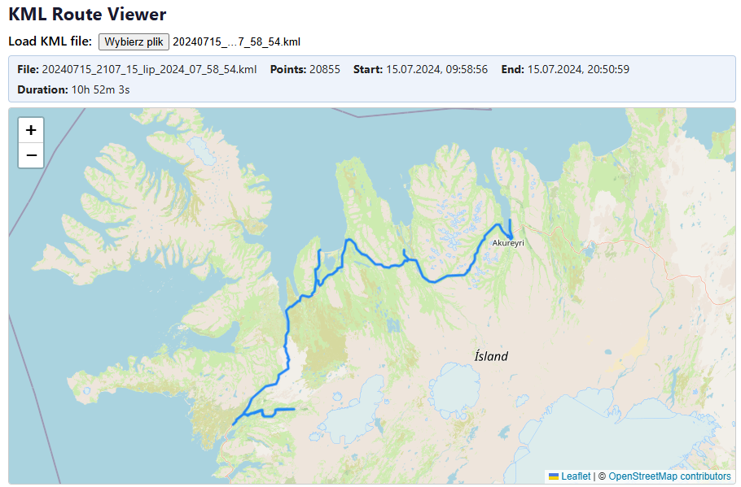

# KML Route Viewer

A local-only Angular application that displays GPS tracks from KML files on an OpenStreetMap-based map.

## Screenshot



## Features

- Load a local `.kml` file using a file picker (no file is sent anywhere — all parsing happens in the browser)
- Parses `gx:MultiTrack` / `gx:Track` KML (Geo Tracker and similar apps) as well as placemark-based
  KML (Flightradar24 flight exports, Google Earth paths) — see [KML Format Support](#kml-format-support)
- Displays the track as a polyline on an interactive Leaflet + OpenStreetMap map
- Auto-fits the map view to the loaded track
- Shows point markers and time labels at high zoom levels (zoom >= 16)
- Click any point marker to see a popup with timestamp, coordinates, and altitude
- Displays a summary: file name, point count, start/end time, total duration
- Shows validation errors for invalid XML, missing tracks, or mismatched element counts

## Requirements

- Node.js 18+
- npm 9+

## Installation & Build

```bash
# from the kml_route_viewer/ directory
npm install
npm run build
```

The production build is written to `dist/kml-route-viewer/browser/`.  
The `build` script runs Angular's build followed by `inline-build.mjs`, which inlines all
JS and CSS into a single `index.html` so the file can be opened directly from the
filesystem in Chrome (which blocks `type="module"` scripts on `file://` origins).

## Running Locally (from the filesystem)

After building, simply open in your browser — no web server needed:

```
dist/kml-route-viewer/browser/index.html
```

Double-click the file or open it via a `file:///` URL in Chrome, Firefox, or Edge.  
Everything is inlined into a single HTML file, so there are no cross-origin requests.

## Development Server

```bash
npm start
# or
npx @angular/cli serve
```

Then open `http://localhost:4200/`.

## KML Format Support

Exporters encode a track in different ways, so the parser tries four strategies in order and uses the
first one that yields points:

1. **`<gx:Track>`** — Geo Tracker and similar GPS loggers
2. **Timestamped `<Point>` placemarks** — Flightradar24 flight exports
3. **`<LineString>` / `<LinearRing>`** — plain Google Earth path exports
4. **Untimed `<Point>` placemarks** — last resort

### 1. `gx:Track`

Primary target: `gx:Track` inside `gx:MultiTrack` (namespaces `http://www.opengis.net/kml/2.2` and `http://www.google.com/kml/ext/2.2`).

Each `<gx:Track>` must contain paired `<when>` and `<gx:coord>` elements:

```xml
<gx:Track>
  <when>2026-01-01T09:01:52Z</when>
  ...
  <gx:coord>19.89075 50.01515 287.34</gx:coord>  <!-- lon lat alt -->
  ...
</gx:Track>
```

Elements may be grouped (all `<when>` then all `<gx:coord>`) or interleaved — both variants are handled.

### 2. Timestamped `<Point>` placemarks

Flightradar24 exports one placemark per position fix, inside a `Route` folder:

```xml
<Placemark>
  <TimeStamp><when>2026-06-07T09:48:22+00:00</when></TimeStamp>
  <Point><coordinates>24.451241,46.242386,11582.4</coordinates></Point>  <!-- lon,lat,alt -->
</Placemark>
```

These files also contain a `Trail` folder that repeats the same geometry as untimed `<LineString>`
segments; because `<gx:Track>` and timestamped points are tried first, the route is read once and
keeps its timestamps. Altitude in `<coordinates>` is in metres, as required by the KML spec.

Since `<gx:Track>` is always preferred, a Geo Tracker file that also carries start/finish `<Point>`
waypoints is parsed from its track exactly as before.

## OpenStreetMap Tile Usage

This app uses the **public OpenStreetMap tile server** (`tile.openstreetmap.org`), which is suitable for **personal, low-traffic local use** only.

> **For any public-facing or higher-traffic deployment**, you must use a dedicated tile provider
> (e.g. a self-hosted tile server, [MapTiler](https://www.maptiler.com/),
> [Stadia Maps](https://stadiamaps.com/), [Thunderforest](https://www.thunderforest.com/), etc.)
> instead of the public OSM tile server. Abusing the free public tile server violates the
> [OSM Tile Usage Policy](https://operations.osmfoundation.org/policies/tiles/).

Map attribution is displayed on the map as required: © [OpenStreetMap contributors](https://www.openstreetmap.org/copyright).

## Project Structure

```
src/
  app/
    kml-parser.service.ts   # KML parsing (DOMParser, namespace-aware)
    map/
      map.component.ts      # Leaflet map rendering
      map.component.html
      map.component.css
    app.ts                  # Root component: file input, summary, error display
    app.html
    app.css
  styles.css                # Global styles (includes .time-label)
  index.html
```

## Dependencies

- [Angular](https://angular.dev/) — framework
- [Leaflet](https://leafletjs.com/) — map rendering
- [@types/leaflet](https://www.npmjs.com/package/@types/leaflet) — TypeScript types
